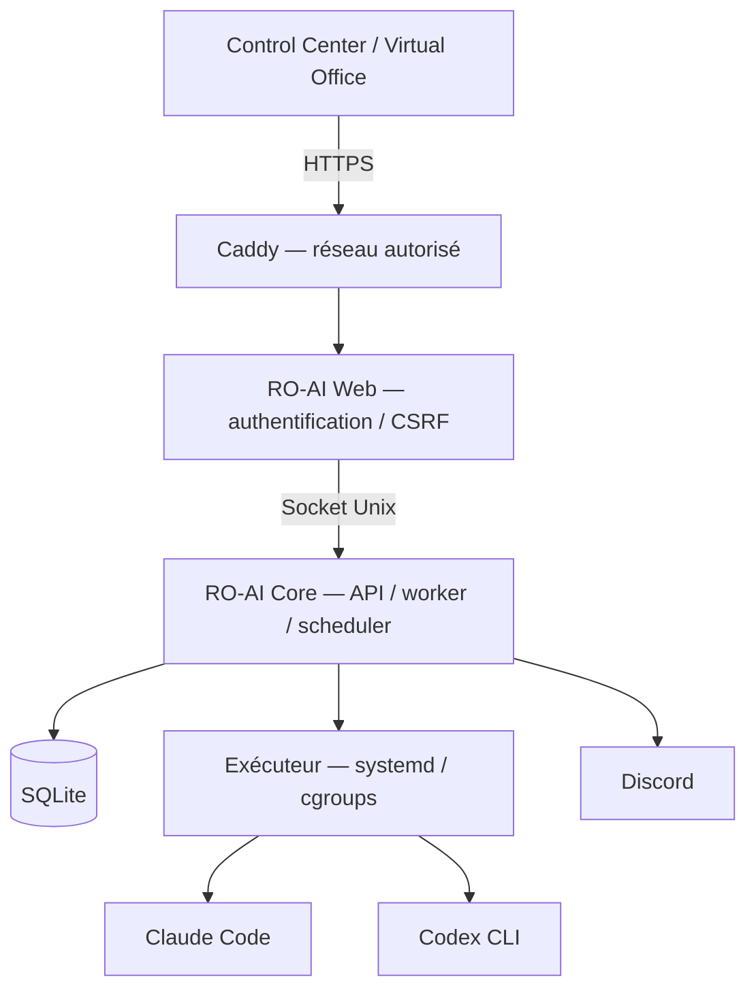

<div align="center">

# RO·AI

**Self-hosted AI Agent Orchestration Platform**

*Your agents. Your infrastructure. Your control.*


[Présentation](#présentation) · [Fonctionnalités](#fonctionnalités) · [Architecture](#architecture) · [Installation](#installation) · [Documentation](#documentation)

</div>

<p align="center">
  
</p>

---

> **Première itération — v0.1.0.** RO·AI est un projet expérimental en développement actif. L'architecture, les fonctionnalités, les mécanismes de sécurité et le déploiement sont voués à évoluer. Cette version ne constitue pas une garantie de stabilité ou de sécurité pour un environnement de production.

## Présentation

**RO·AI** est une plateforme auto-hébergée de gestion, d'orchestration et de supervision d'agents d'intelligence artificielle. Elle centralise les missions, les exécutions, les conversations, les planifications et les permissions dans un environnement unique.

Elle s'appuie sur les clients officiels **Claude Code** et **Codex CLI**. Leur authentification reste gérée par les clients eux-mêmes ; RO·AI ne requiert pas de clé API de facturation pour son fonctionnement principal. Les quotas, modèles et conditions d'utilisation dépendent des fournisseurs.

L'ambition est de transformer des assistants indépendants en une infrastructure opérationnelle observable, automatisable et maîtrisée.

## Fonctionnalités

### Control Center

- Création d'agents spécialisés, configuration des modèles, missions, départements et outils.
- Exécutions manuelles, file d'attente et concurrence par fournisseur.
- Planifications Cron avec fuseau horaire.
- Conversations avec reprise des sessions des clients officiels.
- Journaux d'activité en direct, historique des exécutions et événements.
- Statistiques de consommation, durées, tokens déclarés et estimations de coût.
- Supervision des fournisseurs et des limites d'utilisation.
- Serveurs MCP configurables par agent.
- Approbations de lancement, restrictions d'exécution et arrêt d'urgence persistant.
- Mode léger Claude avec mémoire optionnelle et configuration des outils.

<!-- Future capture: Control Center (docs/images/control-center.png) -->

### Virtual Office

Un siège d'entreprise interactif en pixel art représente l'activité des agents : départements, postes de travail, salles de repos, salle serveur et déplacements sur deux étages.

- État opérationnel alimenté par les événements réels du moteur.
- Plan dynamique, navigation A*, gestion des obstacles et déplacements animés.
- Personnalisation du mobilier, des avatars, des bureaux et des fiches d'identité.
- Simulation sociale locale et désactivable, distincte des activités réelles.
- Tableaux de planification, quotas, archives et suivi des livraisons.
- Fil interne, journal et génération optionnelle de contenu avec limites de consommation.
- Visualisation optionnelle des sessions de développement via un hook local.

La simulation décorative locale n'appelle aucun modèle IA. Les fonctions de génération optionnelles sont distinctes et consomment des quotas.

<!-- Future captures: Virtual Office and social feed (docs/images/) -->

### Fournisseurs IA

| Fournisseur | Client officiel |
|---|---|
| Anthropic | Claude Code |
| OpenAI | Codex CLI |

### Automatisation et intégrations

| Fonction | Description |
|---|---|
| Planification | Missions récurrentes avec Cron et fuseau horaire |
| Conversations | Reprise des sessions des clients officiels |
| Discord | Alertes, rapports, résumés, approbations et commandes du propriétaire |
| Webhooks | Diffusion des rapports ou résumés par agent |
| External Inbox | Réception authentifiée, routage, stockage et traitement de données externes |
| MCP | Configuration de serveurs d'outils par agent |
| Statistiques | Exécutions, durées, tokens déclarés et estimations de coût |
| Contrôle | Approbations, annulation et arrêt d'urgence global |

Exemples de missions : veille technologique et cybersécurité, recherche documentaire, génération de rapports, assistance au développement, analyse de données et traitement d'informations provenant d'applications externes.

## Architecture



| Couche | Technologie |
|---|---|
| Backend | Python, FastAPI |
| Frontend | React, TypeScript, Vite |
| Persistance | SQLite |
| Temps réel | Server-Sent Events |
| Reverse proxy | Caddy |
| Services et isolation | systemd, cgroups, sandbox des clients |
| Moteur graphique | Canvas 2D |

## Sécurité

RO·AI est destiné à un réseau d'administration privé. Il sépare les privilèges du serveur web et du moteur, valide les entrées, masque certains secrets dans les événements et prévoit des limites de concurrence et de ressources.

Les modes libres et autonomes désactivent certaines protections des clients. Le mode de repli sans systemd ne fournit pas les mêmes garanties d'isolation. Il est recommandé d'imposer l'isolation systemd en production, de réserver les modes non restreints à des environnements maîtrisés et de limiter les privilèges des outils MCP.

**Ne pas exposer directement l'interface sur Internet.** Une validation de sécurité indépendante est recommandée avant tout usage sensible.

## Installation

### Environnement cible

Debian 13, notamment en LXC non privilégié compatible avec les mécanismes d'isolation nécessaires.

Le script de déploiement configure les services d'une installation préparée : il ne constitue pas encore un installateur autonome de toutes les dépendances. Préparer les utilisateurs système, les dépendances Python et Node.js, Caddy, les clients officiels et le build frontend conformément à la [documentation d'exploitation](docs/OPERATIONS.md). Les unités attendent notamment le projet sous `/opt/ro-ai`.

### Déploiement

Depuis une installation préparée, exécuter en root avec les paramètres propres à votre réseau :

```bash
cd /opt/ro-ai
ROAI_ADDRESS="ADRESSE_SERVEUR" \
ROAI_LAN="RESEAU_ADMINISTRATION/24" \
bash deploy/install.sh
```

Connecter les fournisseurs nécessaires :

```bash
roai-login claude
roai-login codex
roai-login status
```

Ouvrir ensuite `https://ADRESSE_SERVEUR/` depuis le réseau autorisé. Vérifier la confiance du certificat TLS et les identifiants initiaux selon la documentation d'exploitation.

## Administration

```bash
systemctl status ro-ai-core ro-ai-web caddy
journalctl -u ro-ai-core -f
journalctl -u ro-ai-web -f
```

Arrêt d'urgence et reprise :

```bash
roai-ctl stop "Maintenance"
roai-ctl status
roai-ctl resume
```

## Structure du projet

```text
RO-AI/
├── backend/
│   ├── roai/       # API, moteur, fournisseurs, planification
│   └── tests/      # Tests backend
├── web/
│   └── src/        # Control Center et Virtual Office
├── deploy/         # Services systemd et configuration Caddy
├── docs/           # Documentation technique
├── LICENSE
└── README.md
```

## Développement

Tests backend, dans un environnement Python préparé :

```bash
cd backend
python3 -m pytest -q tests
```

Vérifications frontend :

```bash
cd web
npm ci
npm run typecheck
npm test
npm run build
```

Une pile de développement utilisant des clients simulés est disponible via `deploy/dev-stack.sh`. Elle est réservée au développement local.

## Documentation

| Document | Description |
|---|---|
| [Architecture](docs/ARCHITECTURE.md) | Principes et composants |
| [API](docs/API.md) | Contrats et événements |
| [Exploitation](docs/OPERATIONS.md) | Administration et sauvegardes |
| [Virtual Office](docs/OFFICE.md) | Moteur graphique et simulation |
| [Discord](docs/DISCORD.md) | Configuration et notifications |

## Perspectives

- Collaboration opérationnelle et workflows multi-agents.
- Extension des fournisseurs IA.
- Renforcement de l'isolation et des permissions.
- Amélioration de l'observabilité et de l'installation.
- Enrichissement du Virtual Office.

Ces éléments constituent des pistes d'évolution, pas des fonctionnalités garanties.

## Licence

Distribué sous licence [MIT](LICENSE).

---

<div align="center">

**RO·AI — Your agents. Your infrastructure. Your control.**

Développé par [Rooot3301](https://github.com/Rooot3301).

</div>
